# netdevops-agent-skills

AI agent skills for network automation — transport, parsing, Ansible, Terraform, testing, observability, operations.

Each skill is a self-contained directory with a `SKILL.md` containing domain context, workflow, guardrails, production code, validation commands, vendor compatibility tables, and cross-refs to related skills.

```bash
python3 scripts/validate_skills.py
```

---

## Quick Start

```bash
git clone https://github.com/vsachin094/netdevops-agent-skills.git
cd netdevops-agent-skills
python3 scripts/validate_skills.py
```

**Use a skill** — copy its directory into your project's agent skills folder:

```bash
mkdir -p .agents/skills
cp -R skills/netmiko-core .agents/skills/
cp -R skills/gnmi-client .agents/skills/
```

**Reference in your agent prompt:**

```
Use skills/gnmi-client/SKILL.md.
Build a Python gNMI client that subscribes to interface counters on SR Linux.
Validate with the skill's test suite.
```

---

## Skill Map

```mermaid
graph TD
    classDef transport fill:#e3f2fd,stroke:#1565c0,stroke-width:2px;
    classDef parsing fill:#f3e5f5,stroke:#7b1fa2,stroke-width:2px;
    classDef ansible fill:#e8f5e9,stroke:#2e7d32,stroke-width:2px;
    classDef terraform fill:#fff3e0,stroke:#ef6c00,stroke-width:2px;
    classDef testing fill:#fce4ec,stroke:#c2185b,stroke-width:2px;
    classDef observability fill:#f1f8e9,stroke:#558b2f,stroke-width:2px;
    classDef operations fill:#e0f2f1,stroke:#00695c,stroke-width:2px;
    classDef utilities fill:#fafafa,stroke:#616161,stroke-width:2px;

    subgraph TRANSPORT["Transport (8)"]
        T1[netmiko-core]
        T2[ncclient-restconf]
        T3[paramiko-ssh]
        T4[async-network-automation]
        T5[scrapli-netmiko-threaded]
        T6[gnmi-client]
        T7[gnmi-snmp-telemetry]
        T8[netconf-automation]
    end

    subgraph PARSING["Parsing & Modeling (6)"]
        P1[ntc-textfsm]
        P2[ttp-parsers]
        P3[cli-regex]
        P4[pyang-xpath]
        P5[yang-model-dev]
        P6[network-protocols-as-code]
    end

    subgraph ANSIBLE["Ansible (9)"]
        A1[ansible-role-creation]
        A2[ansible-plugin-development]
        A3[ansible-ee-build]
        A4[ansible-vault-hygiene]
        A5[ansible-dynamic-inventory]
        A6[ansible-resource-modules]
        A7[ansible-linux-networking]
        A8[ansible-netcli-playbooks]
        A9[ansible-pre-post-checks]
    end

    subgraph TERRAFORM["Terraform (8)"]
        TF1[tf-vpc-foundations]
        TF2[tf-aws-networking]
        TF3[tf-azure-gcp-networking]
        TF4[tf-firewall-policies]
        TF5[tf-module-hardening]
        TF6[tf-state-surgery]
        TF7[tf-aci-sdwan-meraki]
        TF8[tf-to-ansible-inventory]
    end

    subgraph TESTING["Testing & Validation (6)"]
        V1[containerlab-topologies]
        V2[batfish-validation]
        V3[network-testing-framework]
        V4[config-diff-audit]
        V5[config-sanitizer]
        V6[network-config-drift-detection]
    end

    subgraph OBSERVABILITY["Observability (1)"]
        O1[network-observability-stack]
    end

    subgraph OPERATIONS["Operations (4)"]
        OP1[gitops-network-automation]
        OP2[network-device-onboarding]
        OP3[network-change-runbooks]
        OP4[nso-device-onboarding]
    end

    subgraph UTILITIES["Utilities (14)"]
        U1[ipam-subnetting]
        U2[jinja2-network-templates]
        U3[cli-tool-packaging]
        U4[network-data-pipelines]
        U5[network-rest-clients]
        U6[network-protocols-as-code]
        U7[netbox-nautobot-api]
        U8[nornir-napalm]
        U9[netconf-automation]
        U10[netconf-restconf-payloads]
        U11[pysnmp-automation]
        U12[pyats-genie]
        U13[ttp-parsers]
        U14[tf-state-surgery]
    end

    %% Key cross-category relationships
    T6 -.-> O1
    T7 -.-> O1
    V1 --> V3
    V2 --> V3
    V4 --> V6
    V5 --> V6
    OP1 --> V1
    OP2 --> V1
    OP3 --> V4
    A9 --> OP3
    U2 --> P6
    A1 --> OP3
    TF8 --> A5
    P6 --> A6
    T8 --> A7
    P4 --> P1
    P4 --> P2

    class T1,T2,T3,T4,T5,T6,T7,T8 transport;
    class P1,P2,P3,P4,P5,P6 parsing;
    class A1,A2,A3,A4,A5,A6,A7,A8,A9 ansible;
    class TF1,TF2,TF3,TF4,TF5,TF6,TF7,TF8 terraform;
    class V1,V2,V3,V4,V5,V6 testing;
    class O1 observability;
    class OP1,OP2,OP3,OP4 operations;
    class U1,U2,U3,U4,U5,U6,U7,U8,U9,U10,U11,U12,U13,U14 utilities;
```



---

## Skills by Category

### Transport (8)
| Skill | Purpose |
|-------|---------|
| `netmiko-core` | Inventory-driven SSH with Netmiko — per-device results, config_mode per platform, `--check`/`--diff` |
| `ncclient-restconf` | NETCONF/RESTCONF with transactions — candidate datastore, locks, confirmed commit |
| `paramiko-ssh` | Raw SSH/SFTP — strict host-key verify, timeouts, command allow-list |
| `async-network-automation` | High-concurrency async SSH/HTTP — semaphores, bounded queues, cancellation |
| `scrapli-netmiko-threaded` | Threaded fleet execution — ThreadPoolExecutor, exception isolation |
| `gnmi-client` | Programmatic gNMI Get/Set/Subscribe — Python + Go, TLS/mTLS, typed values |
| `gnmi-snmp-telemetry` | gNMI/SNMP collection config — gnmic, snmp_exporter, PromQL alerts |
| `netconf-automation` | NETCONF patterns — capabilities, filters, edit-config, validated commits |

### Parsing & Modeling (6)
| Skill | Purpose |
|-------|---------|
| `ntc-textfsm` | TextFSM templates — version handling, Filldown leak tests, NTC index |
| `ttp-parsers` | Hierarchical TTP — nested config, matchers, dynamic paths |
| `cli-regex` | Pure Python regex — named groups, ANSI strip, typed extraction |
| `pyang-xpath` | YANG schema inspection — tree views, exact XPaths |
| `yang-model-dev` | Author YANG 1.1 modules — constraints, leafrefs, pyang lint |
| `network-protocols-as-code` | Vendor-neutral intent → config — L2/L3/BGP/EVPN, multi-vendor |

### Ansible (9)
| Skill | Purpose |
|-------|---------|
| `ansible-role-creation` | Reusable multi-vendor roles — Molecule, argument_specs, platform task split |
| `ansible-plugin-development` | Custom modules/filters/connection — check_mode, ansible-test |
| `ansible-ee-build` | Pinned execution environments — requirements.yml/txt, bindep.txt |
| `ansible-vault-hygiene` | Secret management — vault-id per env, no_log boundaries, trufflehog/gitleaks |
| `ansible-dynamic-inventory` | NetBox/AWS/Azure/Terraform sources — keyed_groups, compose, caching |
| `ansible-resource-modules` | Declarative network resources — merged/replaced/overridden/deleted |
| `ansible-linux-networking` | Linux host networking — Netplan/NM, FRR, nftables, WireGuard |
| `ansible-netcli-playbooks` | Foundational network playbooks — FQCNs, network_cli, backup |
| `ansible-pre-post-checks` | Change safety wrapper — baseline → change → verify → rollback |

### Terraform (8)
| Skill | Purpose |
|-------|---------|
| `tf-vpc-foundations` | Base VPC/VNet modules — CIDR validation, flow logs |
| `tf-aws-networking` | AWS VPC, TGW, DX, firewall — multi-AZ, route associations |
| `tf-azure-gcp-networking` | Azure/GCP hub-spoke, peering — VNet peering, Cloud Router/NAT |
| `tf-firewall-policies` | Palo/Forti/Check Point/Cloudflare — stable keys, shadow analysis |
| `tf-module-hardening` | Secure modules — tflint/Trivy/Checkov, pin providers |
| `tf-state-surgery` | Declarative state migration — moved/import/removed blocks |
| `tf-aci-sdwan-meraki` | Controller-based — hierarchy, stable for_each, async readiness |
| `tf-to-ansible-inventory` | TF outputs → Ansible inventory — structured outputs, readiness checks |

### Testing & Validation (6)
| Skill | Purpose |
|-------|---------|
| `containerlab-topologies` | Lab topologies as code — pinned images, startup config validation |
| `batfish-validation` | Mathematical network analysis — BGP/OSPF/ACL/reachability |
| `network-testing-framework` | pytest + Containerlab + Batfish — unit/integration/contract |
| `config-diff-audit` | Config drift detection — normalization, volatile stripping |
| `config-sanitizer` | Config/log redaction — deterministic placeholders, topology preservation |
| `network-config-drift-detection` | Scheduled drift detection — collect → normalize → diff → alert → remediate |

### Observability (1)
| Skill | Purpose |
|-------|---------|
| `network-observability-stack` | Prometheus/Grafana/Loki/Tempo — snmp_exporter, gnmic, PromQL alerts |

### Operations (4)
| Skill | Purpose |
|-------|---------|
| `gitops-network-automation` | ArgoCD/Flux for network config — Kustomize overlays, pre/post sync hooks |
| `network-device-onboarding` | Day-0: ZTP, creds, host-keys, verify — idempotent, rollback per stage |
| `network-change-runbooks` | Auditable change execution — pre-checks, approval gates, rollback, evidence |
| `nso-device-onboarding` | NSO-specific onboarding — authgroups, NED assignment, sync-from |

### Utilities (14)
| Skill | Purpose |
|-------|---------|
| `ipam-subnetting` | Hierarchical CIDR allocation — VLSM, overlap detection, NetBox/TF seed data |
| `jinja2-network-templates` | Multi-vendor templates + filters — capability registry, StrictUndefined |
| `cli-tool-packaging` | Packaged Python CLIs — Typer/Click, Rich, dry-run, JSON output |
| `network-data-pipelines` | Pandas/Polars + Pydantic — normalization, cardinality control, quarantine |
| `network-rest-clients` | Typed REST clients — timeouts, retries, pagination, idempotency keys |
| `network-protocols-as-code` | Intent → multi-vendor config — BGP/OSPF/EVPN, unsupported feature findings |
| `netbox-nautobot-api` | NetBox/Nautobot client — GraphQL bulk, pagination, dry-run |
| `nornir-napalm` | Fleet automation with Nornir — inventory layers, compare/commit/discard |
| `netconf-automation` | NETCONF patterns — lock/validate/commit, capability check |
| `netconf-restconf-payloads` | XML/JSON payload construction — schema validation, Pydantic models |
| `pysnmp-automation` | SNMP v1/v2c/v3 async — GET/BULK/SET, traps, MIB resolution |
| `pyats-genie` | Cisco Genie parsers + AEtest — MetaParser, differential pre/post |
| `tf-state-surgery` | State migration — moved/import/removed, zero-destroy verify |
| `ttp-parsers` | Hierarchical text parsing — TTP templates, nested output, matchers |

---

## Each Skill Contains

```
skills/<skill-slug>/
├── SKILL.md              # Full spec: workflow, guardrails, code, validation
├── scripts/
│   └── validate_*.py     # Runnable validator (pytest, linter, schema check)
└── references/           # (optional) local fixtures, schemas
```

**Run a skill's validator:**
```bash
python3 skills/netmiko-core/scripts/validate_runner.py --help
python3 skills/gnmi-client/scripts/validate_client.py --help
```

---

## Agent Integration

| Agent | Project Location | Explicit Use |
|-------|------------------|--------------|
| Claude Code | `.claude/skills/<slug>/SKILL.md` | `/skill <slug>` |
| GitHub Copilot | `.github/skills` or `.agents/skills` | `/skill <slug>` or natural language |
| Cursor | Workspace + `@skills/<slug>/SKILL.md` | `@skills/<slug>/SKILL.md` |
| Continue | Workspace + `.continue/rules` | Project rule or attached file |
| Local LLM | Any readable directory | Paste SKILL.md or reference path |

---

## Offline Use

Skills work offline with local dependencies. See [references/open-source-local.md](references/open-source-local.md) for recommended layout, dependency tiers, and quality gates.

---

## Contributing

1. Add skill at `skills/<lowercase-hyphenated-slug>/SKILL.md`
2. Include runnable validator in `scripts/`
3. Follow the skill structure (frontmatter + 9 required sections)
4. No credentials, private keys, customer data, proprietary files
5. Run `python3 scripts/validate_skills.py` before PR

---

## License

MIT. Vendor names and product marks remain property of their respective owners.